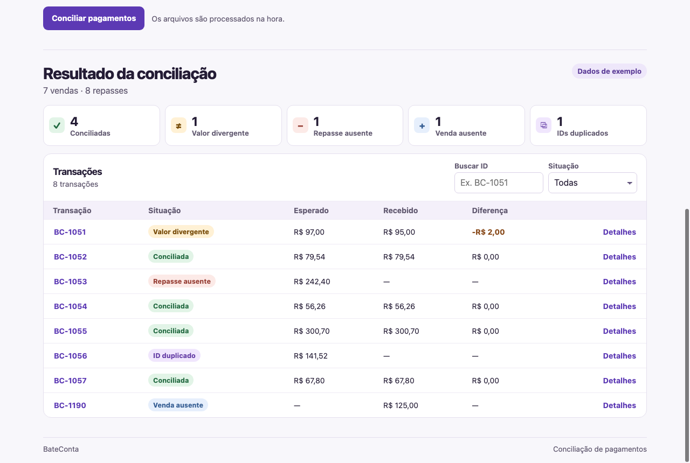

# BateConta

Demo de conciliação financeira em **Java 21 e Spring Boot**. Importe o CSV de vendas e o relatório de repasses da operadora para comparar as transações pelo identificador externo. O botão **Usar dados de exemplo** carrega um cenário com todas as situações.

[**Testar a demo online**](https://bateconta.onrender.com/)

## Rodar localmente

Com Java 21 e Maven instalados, execute `mvn spring-boot:run` e abra [http://localhost:8080](http://localhost:8080). Rode `mvn test` para executar a suíte.

## Importar arquivos

| Arquivo | Colunas |
| --- | --- |
| [Vendas da loja](src/main/resources/static/exemplos/vendas.csv) | `id_transacao`, `valor_bruto`, `taxa` |
| [Repasses da operadora](src/main/resources/static/exemplos/repasses.csv) | `id_transacao`, `valor_repassado` |

Use CSV em UTF-8, delimitado por vírgula ou ponto e vírgula. Os valores aceitam até duas casas decimais, sem separador de milhar. Se o delimitador for vírgula, coloque valores com vírgula decimal entre aspas. Cada arquivo pode ter até 1 MB e 5.000 registros. IDs são comparados exatamente após remover espaços nas extremidades.

O BateConta calcula o líquido esperado em centavos e subtrai esse valor do repasse recebido. No exemplo, uma venda de R$ 100,00 com taxa de R$ 3,00 deveria receber R$ 97,00. Como foram repassados R$ 95,00, o relatório destaca uma diferença de R$ 2,00 a menos.

O painel também identifica vendas sem repasse, repasses sem venda e IDs duplicados. Cada linha mantém os registros de origem para investigação.

## Arquitetura

O Spring Boot serve a interface e recebe os CSVs por multipart. A aplicação processa os bytes em memória, agrupa os registros pelo identificador e devolve o resultado em JSON. Não há banco de dados nem armazenamento dos uploads. O Dockerfile empacota o JAR e o Blueprint configura um serviço web gratuito no Render, com verificação de saúde em `/actuator/health`.
